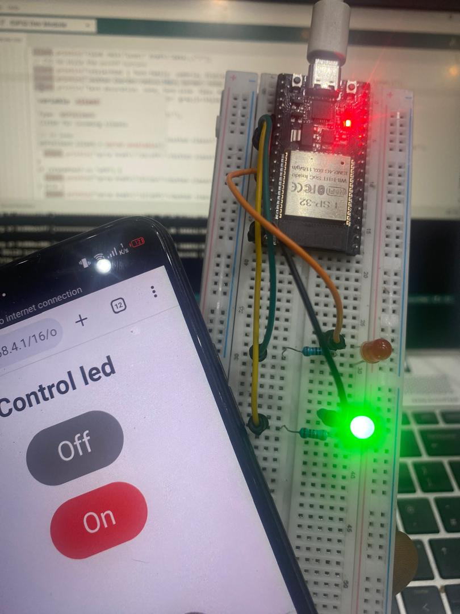

# Control LEDs

Through this project completed, I wanted to understand how Arduino, ESP32, and web development can work together. In general, I wanted to dive into more on IoT (Internet of Things).

